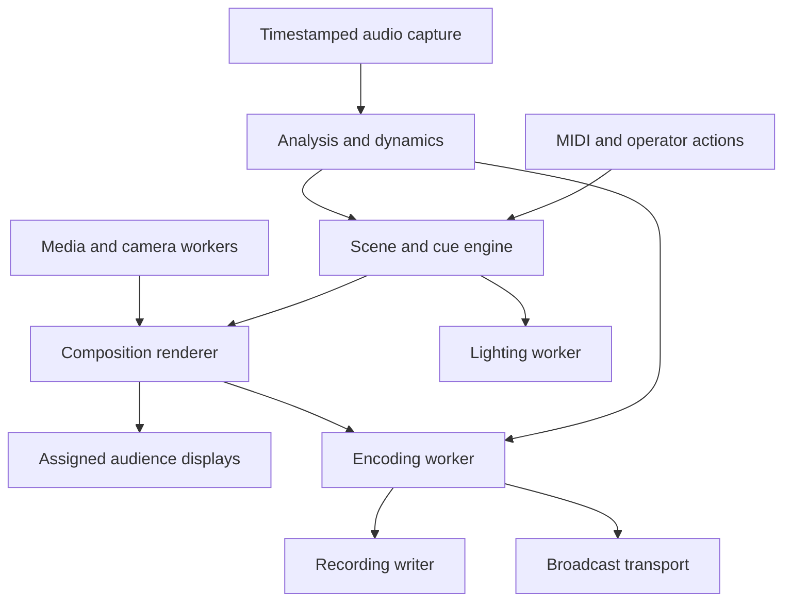

# StageSignal: specification and research package

Version 0.1, revision 1 • 10 October 2026 • Circuit Drift Labs

**Status:** design baseline for estimation and feasibility work. No application implementation, build, hardware benchmark, protocol interoperability test, or legal clearance has been performed. Numerical limits below are proposed acceptance targets, not measured capabilities.

## 1. Executive summary and project definition

StageSignal is a Windows live-performance visualizer, video mixer, show controller, recorder, and lighting controller for DJs, bands, and small venues. The operator uses the primary screen; the audience sees a separate output. A third screen can provide controls or another visual output. Audio, camera, text, imported media, MIDI, lighting, recording, and optional broadcasting form one operator workflow.

The owner has fixed the minimum CPU and RAM at the Windows Vista Home Basic hardware floor: an 800 MHz processor and 512 MB total installed system RAM [SRC-22]. StageSignal must provide a responsive, smooth basic live show on this floor, not merely install or launch. Qualification assumes one CPU core and no modern SIMD requirement unless an optional accelerated path has a compatible fallback. VGA 800×600 remains the minimum visual output. Supported Windows versions, actual CPU models/instructions, graphics driver and display topology still need qualification. This hardware choice does not by itself require Vista operating-system support or prove that every heavy feature can run concurrently.

**Recommendation:** build a small procedural rendering baseline and enable heavier features according to measured capability. Preserve the full product scope through milestones; do not advertise the first beta as the complete product. The old-hardware requirement remains an explicit feasibility gate, not a promise silently replaced by a modern PC requirement.

Provisional stack: C++17 core; CMake; native Windows controls through wxWidgets; software raster output for basic scenes; optional OpenGL/projectM renderer; WASAPI capture with device timestamps; Media Foundation camera adapter; RtMidi; narrowly configured FFmpeg media/encoding worker; focused Art-Net adapter and an evaluated ETCLabs sACN integration. miniaudio is a candidate for a portable/legacy audio adapter, subject to timestamp verification. Dependencies are proposals pending pinned-version audits.

Product success means a single performer can complete setup, launch a saved show, take manual control, restore automation, and recover from ordinary device failures without exposing operator controls to the audience. Release acceptance is tied to the tests and hardware records in this package.

Non-goals: DAW plug-in formats, professional projection mapping, a lighting-console replacement, remote public control servers, cloud accounts, automatic track identification, guaranteed key/BPM accuracy, DRM circumvention, arbitrary scripting, and simultaneous recording of every output in beta. These may be separately proposed later.

## 2. Confirmed inputs, assumptions, and decisions

| Class | ID | Input or decision | Consequence |
|---|---|---|---|
| Confirmed | IN-01 | Windows standalone application; DJs, bands, venues | Desktop workflow and native device access |
| Confirmed | IN-02 | Primary controls, second visual output, flexible third and additional displays | Logical outputs must be separate from monitor indices |
| Confirmed | IN-03 | Vista Home Basic CPU/RAM floor: 800 MHz, single-core qualification, 512 MB total RAM; VGA 800×600 output | Smooth BASE live-show profile is mandatory; measured physical-machine evidence required |
| Confirmed | IN-04 | Autonomous, programmed, and hybrid shows | Shared scene/action engine with explicit ownership |
| Confirmed | IN-05 | Audio analysis, camera, text, GIF/image/video, MIDI in/out, DMX | All retained in eventual scope |
| Confirmed | IN-06 | Benchmark, adaptation, A/V recording with compressor/limiter, broadcast | Independent workers and capability qualification |
| Confirmed | IN-07 | Local-first, offline core; keyboard/MIDI controls; portable shows | No login or online activation dependency assumed |
| Verified observation | OBS-01 | GitHub repository reader returned HTTP 409, “Git Repository is empty,” for stage-signal on access date | No existing code or configuration inspected; no repository changes made |
| Assumption | AS-01 | Control interface must also fit 800×600 at 100% scaling | Compact tabs; minimum effective client size disclosed |
| Assumption | AS-02 | x86-compatible baseline build and separately qualified modern x64 build | A modern-only beta cannot satisfy the 800 MHz/512 MB requirement; OS/toolchain selection must accommodate the baseline |
| Assumption | AS-03 | Camera and recording use a single selected program output in beta | Additional output capture remains later scope |
| Assumption | AS-04 | Commercial redistribution may eventually matter | Prefer permissive core and replaceable LGPL libraries |
| Recommendation | DEC-01 | Original procedural pack as default content | Clear provenance; deterministic resource budgets |
| Recommendation | DEC-02 | No full OLA daemon or libobs dependency in beta | Narrow adapters and smaller packaging surface |
| Open | Q-01 | Which 800 MHz CPU model, OS/build, GPU/driver and physical display connectors form the qualification fixture? | CPU/RAM floor fixed; physical fixture details block certification |
| Open | Q-02 | Which Windows versions must run on the fixed 800 MHz/512 MB floor, including whether Vista itself is required? | Determines API/toolchain support; stronger hardware cannot substitute for minimum-tier qualification |
| Open | Q-03 | Required first broadcast destinations and USB-DMX models? | Blocks endpoint-specific and adapter-specific qualification |
| Open | Q-04 | GPL/AGPL acceptable, and intended StageSignal source license? | Blocks dependency/distribution approval |
| Open | Q-05 | Minimum independent outputs; camera format; recording quality/all outputs? | Blocks final hardware sizing |

Questions Q-01, Q-02, and Q-04 must be resolved before locking the production stack. Other questions have provisional defaults below and owners in §23. All “shall” statements are proposed normative requirements for the build, not statements of existing behavior.

## 3. Users, journeys, and use cases

| Journey | Steps | Expected outcome and recovery |
|---|---|---|
| UJ-01 Pre-show setup | Open wizard; identify displays using operator-triggered labels; assign roles; choose audio; set physical gain; preview camera; map MIDI; choose lighting interface; select recording folder; benchmark | Save qualified profile. DMX and broadcasting remain off. Missing required media listed before performance |
| UJ-02 DJ autonomous show | Load pool; select Auto; choose tap/manual/estimated tempo; start visuals | Weighted scene changes at valid boundaries; no repeat within configured history; manual scene selection changes to Hybrid override |
| UJ-03 Band show | Load setlist; trigger songs/cues with foot controller; type message in draft; explicitly publish | Follow cues without assuming fixed BPM or key; free-time passages use elapsed-time transitions |
| UJ-04 Venue operator | Arm known lighting outputs; start programmed cues; monitor status | Master blackout wins over every cue. Setup/preview commands never transmit live lighting |
| UJ-05 Recording | Verify meters and disk space; choose program output; start; add markers; stop | Processed audio and selected composition recorded. Full disk finalizes recoverable segment and reports interruption |
| UJ-06 Broadcast | Configure endpoint and secret; review chosen A/V output; explicitly start | Distinct live state; network failure reconnects only within user-selected policy; local recording continues |
| UJ-07 Display/input failure | Unplug projector, audio interface, or camera while running | Controls stay accessible; output route pauses or falls back as specified; no audience window migrates onto control display automatically |
| UJ-08 Overload | Enable camera/encoding on a weak machine | Explain failed admission; if already running, shed permitted visual work without blocking audio capture or growing queues |

DJ and band workflows use the same show model. The extra control surface edits that model through the same action broker and receives its current state; it does not own a separate copy of the show.

## 4. Feature inventory and scope

Effort classes are relative engineering estimates: S = a contained adapter/control; M = multiple states and tests; L = substantial integration; XL = substantial hardware/codec/protocol qualification. They are not elapsed-time estimates.

| Capability | Release allocation | Dependencies | Cost |
|---|---|---|---|
| Basic procedural scenes, audio meter/bands/onsets, text, still images | MVP, M1–M3 | Audio, clock, raster, UI | L |
| Screen assignment, duplication, reconnect, 800×600 controls | MVP, M1–M3 | Display adapter, action engine | L |
| Auto/manual/hybrid and programmed show files | MVP, M2–M3 | Scheduler, assets, persistence | L |
| BPM confidence, tap/manual; key confidence/manual | MVP; estimate qualification M2 | Analyzer, validation corpus | L |
| MIDI learn/input; notes/CC/clock output | Performance beta, M4 | Bounded routing/scheduler | M |
| Camera PIP/mirror/tint/threshold/posterize/split screen; GIF/video | Performance beta, M4 | Capture/decode workers | L |
| Motion trails, extra independent output, projectM | Enhanced tier, M4–M6 | GPU/resource admission | L |
| Art-Net and sACN; generic dimmer/RGB profiles | Performance beta, M4 | Dedicated lighting engine | L |
| Named USB-DMX adapters and advanced fixture profiles | Subsequent release, M6 | Owner-selected hardware | L |
| A/V and audio-only recording, dynamics | Recording beta, M5 | Timestamped capture, encoder, disk | XL |
| RTMPS and SRT broadcast | Broadcast beta, M6 | Encoder, TLS/network qualification | XL |
| RTP local contribution; WebRTC | RTP later M6; WebRTC deferred | Receiver profiles; signaling for WebRTC | L/XL |
| Show event journal/markers, backup/export | Journal MVP; record markers M5 | Show model, persistence | M |
| Audience sound-driven moments/silhouettes | Optional M7 | Existing camera/analysis; opt-in | M |
| All-output recording, projection mapping, plug-ins | Deferred/out of first release | Further requirements and sizing | XL |

These release labels organize delivery. A feature being confirmed does not make it mandatory in the first MVP. A full StageSignal release requires all confirmed capabilities either implemented and qualified on named tiers or explicitly renegotiated with the owner.

## 5. Functional requirements

Priority P0 protects operation/data/privacy; P1 delivers required product behavior; P2 is optional enhancement. Each row defines one testable outcome. Detailed edge behavior appears in the linked domain sections. Test families in §18 own the test cases derived from these criteria. Source codes refer to confirmed inputs above; module IDs refer to §9.

### Audio and analysis

| ID / priority / source | Required outcome and acceptance criterion | Owner / verification |
|---|---|---|
| REQ-A01 P1 IN-05 | Select one physical capture endpoint and mono/stereo channel route; enumeration/open tests show selected stable identity and negotiated rate | MOD-02 / T-AUD |
| REQ-A02 P0 IN-05 | Display unavailable/denied/disconnected audio state within 1 s of notification; never silently select another microphone | MOD-02 / T-FAULT |
| REQ-A03 P1 IN-05 | Publish RMS, peak, and low/mid/high energy; calibrated tones select expected band and RMS within 0.5 dB outside boundary transitions | MOD-03 / T-DSP |
| REQ-A04 P1 IN-05 | Produce onset events; synthetic pulse corpus yields ≥95% matched events within ±50 ms with ≤5% false detections | MOD-03 / T-DSP |
| REQ-A05 P1 IN-05 | Display tempo estimate with confidence and age; silence becomes Unknown; 60–180 BPM click corpus within ±2% after 10 s | MOD-03 / T-TEMPO |
| REQ-A06 P1 IN-05 | Tap/manual BPM overrides estimates until explicitly released; deterministic tap and override tests pass | MOD-04 / T-SHOW |
| REQ-A07 P1 IN-05 | Display key estimate/confidence or Unknown; ambiguous/noisy/silent corpus shall not force a key above reporting threshold | MOD-03 / T-KEY |
| REQ-A08 P1 IN-05 | Manual key entry overrides detector without changing input audio; save/load preserves override | MOD-04 / T-KEY |
| REQ-A09 P1 IN-02 | BPM/key visibility is configured per logical visual output; audience capture tests reflect only enabled labels | MOD-05 / T-UI |
| REQ-A10 P0 IN-06 | Input and processed output clipping/activity meters remain distinguishable; upstream full-scale test warns even when output limiter reduces level | MOD-03 / T-DSP |

### Screens and operator control

| ID / priority / source | Required outcome and acceptance criterion | Owner / verification |
|---|---|---|
| REQ-D01 P1 IN-02 | Assign primary controls and second audience output; launch/restart preserves roles on matched display identities | MOD-05 / T-DISPLAY |
| REQ-D02 P1 IN-02 | Assign third screen as controls or visuals; both configurations operate without creating a second show-state owner | MOD-01 / T-DISPLAY |
| REQ-D03 P1 IN-02 | Additional screens duplicate or host independent logical outputs; disabled features explain measured capability limit | MOD-05 / T-DISPLAY |
| REQ-D04 P1 IN-03 | Render into an 800×600 target with correct aspect fit; reference borders remain visible in VGA output test | MOD-06 / T-DISPLAY |
| REQ-D05 P0 IN-02 | Audience windows contain no diagnostics unless explicitly enabled; full-screen focus/tab changes retain assigned display | MOD-05 / T-UI |
| REQ-D06 P0 IN-02 | Lost output is marked disconnected; it never automatically covers controls; reattach requires identity match and safe route restore | MOD-05 / T-FAULT |
| REQ-D07 P1 IN-02 | Rotation/resolution changes recompute normalized composition without changing show content; 4:3/16:9/portrait tests pass | MOD-06 / T-DISPLAY |
| REQ-D08 P0 IN-07 | Blackout toggles final audience composition by next admitted frame; controls remain visible; restore retains prior scene state | MOD-05 / T-SHOW |
| REQ-D09 P1 IN-07 | Idle screen is configurable; audio loss obeys selected continue/idle policy within 2 s | MOD-04 / T-FAULT |
| REQ-D10 P1 IN-07 | Setup wizard can be completed with keyboard at 800×600 effective client area; no required control inaccessible | MOD-01 / T-UI |
| REQ-D11 P1 IN-07 | Brightness/speed/intensity/color/next-scene actions reach active scene through keyboard and MIDI mappings | MOD-04 / T-UI |

### Show, media, and camera

| ID / priority / source | Required outcome and acceptance criterion | Owner / verification |
|---|---|---|
| REQ-S01 P1 IN-04 | Autonomous selection obeys pool eligibility, minimum dwell, and repeat history; seeded sequence tests are reproducible | MOD-04 / T-SHOW |
| REQ-S02 P1 IN-04 | Programmed cues carry scene, duration, transition, media/text, and optional lighting references; test show executes declared ordering | MOD-04 / T-SHOW |
| REQ-S03 P0 IN-04 | Manual override pauses scheduled scene changes until Resume; no automatic cue fires during override tests | MOD-04 / T-SHOW |
| REQ-S04 P1 IN-04 | Pause/Resume preserves cue position; Resume offers current-cue continuation or next-cue progression without surprise jump | MOD-04 / T-SHOW |
| REQ-S05 P1 IN-05 | Text drafts are editable without publishing; only Publish changes selected audience outputs | MOD-01 / T-UI |
| REQ-S06 P1 IN-05 | Text supports placement, size, color, duration, fade and bounded scroll; Unicode/long text follows §13 limits | MOD-06 / T-MEDIA |
| REQ-S07 P1 IN-05 | Import stills, GIF, and declared video profiles; loop, speed, crop and transition tests match §13 | MOD-07 / T-MEDIA |
| REQ-S08 P0 IN-05 | Missing/invalid media retains valid current scene or substitutes documented placeholder; no control thread blocks on decode | MOD-07 / T-FAULT |
| REQ-S09 P1 IN-05 | Selected camera preview and composition use negotiated format/rate; device status is visible before publication | MOD-08 / T-CAM |
| REQ-S10 P1 IN-05 | PIP, mirror, tint, threshold, posterize, split-screen and bounded trail settings affect only routed camera layers | MOD-06 / T-CAM |
| REQ-S11 P0 IN-05 | Lost camera freezes for ≤500 ms then hides layer or uses chosen placeholder; no automatic alternate-camera selection | MOD-08 / T-FAULT |
| REQ-S12 P0 IN-07 | Disable Strobing prevents explicit flash/strobe presets and mappings in software scenes and controlled fixture channels | MOD-04 / T-SHOW |
| REQ-S13 P1 IN-07 | Show import/export preserves settings, cues, mappings and included media references; relocated bundle loads offline | MOD-13 / T-DATA |
| REQ-S14 P0 IN-07 | Invalid show/schema/path is rejected before replacing live state; old show stays active | MOD-13 / T-SEC |
| REQ-S15 P1 IN-05 | Every bundled asset has provenance/license/checksum manifest entry; packaging fails on absent or mismatched entry | MOD-07 / T-LICENSE |
| REQ-S16 P1 IN-07 | Core setup/show/render/media operation works with network disabled; no login screen blocks startup | MOD-01 / T-OFFLINE |

### MIDI and lighting

| ID / priority / source | Required outcome and acceptance criterion | Owner / verification |
|---|---|---|
| REQ-M01 P1 IN-05 | MIDI input learn binds device/channel/message/value range to named action; inspect/edit/delete roundtrip passes | MOD-09 / T-MIDI |
| REQ-M02 P1 IN-05 | MIDI output sends notes/CC on selected port and scheduled MIDI clock; capture receiver verifies routing/order/timing | MOD-09 / T-MIDI |
| REQ-M03 P0 IN-05 | Feedback-risk routes require explicit enable; triggered echo test is rate-limited and trips loop protection | MOD-09 / T-MIDI |
| REQ-M04 P0 IN-05 | Lost MIDI connection marks mapping unavailable within 1 s of detected loss; reconnect sends no stale queued actions | MOD-09 / T-FAULT |
| REQ-L01 P1 IN-05 | Fixture profiles map declared universe/start address/channels to intensity/color; bounds/conflict tests pass | MOD-10 / T-DMX |
| REQ-L02 P1 IN-05 | Art-Net and sACN adapters transmit validated frames on selected interface/destination; receiver and packet tests pass | MOD-10 / T-DMX |
| REQ-L03 P0 IN-05 | Preview/setup/benchmark transmit zero lighting datagrams; socket instrumentation verifies isolation | MOD-10 / T-DMX |
| REQ-L04 P0 IN-05 | Master lighting blackout overrides every intensity/strobe cue by next lighting tick; configured non-intensity safe values retained | MOD-10 / T-DMX |
| REQ-L05 P0 IN-05 | Disconnect/fault is reported; reconnected lighting stays disarmed until explicit Arm | MOD-10 / T-FAULT |
| REQ-L06 P1 IN-05 | Each supported USB adapter is named with driver/protocol/version and qualification results; unsupported adapter is never called generic-compatible | MOD-10 / T-DMX |

### Benchmark, recording, and broadcast

| ID / priority / source | Required outcome and acceptance criterion | Owner / verification |
|---|---|---|
| REQ-P01 P1 IN-06 | Benchmark reports scenario/configuration, FPS, frame times/drops, CPU, memory and skipped tests; same fixture generates comparable records | MOD-14 / T-PERF |
| REQ-P02 P0 IN-06 | Benchmark never initiates remote broadcast; recording encode sink and lighting adapters use isolated test targets | MOD-14 / T-SEC |
| REQ-P03 P1 IN-06 | Sustained pressure invokes one adaptation step at a time with hysteresis; artificial load test produces §7 sequence | MOD-14 / T-PERF |
| REQ-P04 P1 IN-06 | Locked quality stays unchanged; overload warning appears rather than silently changing locked profile | MOD-14 / T-PERF |
| REQ-P05 P0 IN-06 | Queues/memory remain bounded during slow disk/network/decode tests; audio capture never waits on consumer work | MOD-02 / T-RT |
| REQ-R01 P1 IN-06 | Record selected program output and selected audio bus in declared container/codec profile | MOD-11 / T-REC |
| REQ-R02 P1 IN-06 | Compressor/limiter processing is on by default for recording; bypass/settings/activity are visible and recorded in metadata | MOD-03 / T-DSP |
| REQ-R03 P0 IN-06 | A/V timestamps compensate audio processing/encoder delay; flash-click sync meets §12 target after one hour | MOD-11 / T-SYNC |
| REQ-R04 P0 IN-06 | Disk-low/error stops writer gracefully where possible and leaves recoverable completed segments; fault test distinguishes lost interval | MOD-11 / T-FAULT |
| REQ-R05 P1 IN-06 | Audio-only recording is available without video renderer/encoder admission; PCM format/header recovery tested | MOD-11 / T-REC |
| REQ-R06 P0 IN-06 | Codec unavailable/full disk/capture invalid produces actionable start failure before claiming Recording | MOD-11 / T-REC |
| REQ-B01 P1 IN-06 | RTMPS and SRT profiles connect to qualified receivers using selected A/V output; protocol settings are explicit | MOD-12 / T-CAST |
| REQ-B02 P0 IN-06 | Broadcast starts only on explicit user action; show load/restart/benchmark never initiates transmission | MOD-12 / T-SEC |
| REQ-B03 P0 IN-06 | Secrets never appear in show exports/logs/support bundle; storage and redaction tests pass | MOD-15 / T-SEC |
| REQ-B04 P1 IN-06 | Network failure obeys bounded reconnect policy; local recording remains active during receiver outage | MOD-12 / T-CAST |
| REQ-B05 P1 IN-06 | Expose connection/bitrate/drop/error/live state and start/stop controls; Stop cancels reconnect within 1 s | MOD-12 / T-CAST |
| REQ-B06 P0 IN-06 | Broadcasting remains optional; disabling network functionality preserves all local show features | MOD-12 / T-OFFLINE |
| REQ-B07 P2 IN-06 | RTP contribution, when enabled, exports matching receiver description and labels encryption status | MOD-12 / T-CAST |

### Data, reliability, and usability

| ID / priority / source | Required outcome and acceptance criterion | Owner / verification |
|---|---|---|
| REQ-X01 P0 IN-07 | Show saves are atomic and retain prior recoverable version; crash-at-write test restores valid version | MOD-13 / T-DATA |
| REQ-X02 P1 IN-07 | Common live actions are keyboard reachable with visible focus and non-color-only state labels | MOD-01 / T-UI |
| REQ-X03 P0 IN-07 | Local decoder worker failure does not terminate show/audio/UI; fault test substitutes failed source | MOD-07 / T-FAULT |
| REQ-X04 P0 IN-07 | No public network listener is enabled by default; port scan during offline/default setup verifies declared sockets | MOD-15 / T-SEC |
| REQ-X05 P1 IN-07 | Record sanitized diagnostic event/marker timeline with monotonic and wall-clock references | MOD-16 / T-DATA |
| REQ-X06 P0 IN-06 | Supported profile survives 4 h soak without crash, stuck blackout, unbounded growth, or undeclared recording loss | MOD-14 / T-SOAK |

## 6. System and hardware compatibility

**The BASE CPU/RAM floor is confirmed; performance targets and higher tiers are design requirements awaiting measurement.** No hardware configuration has been certified. Installation success alone is insufficient: the mandatory basic live-show profile must pass its benchmark and soak tests on a physical 800 MHz, single-core, 512 MB machine. Record memory reserved for integrated graphics and RAM available to the OS. RAM refers to the whole computer, not an app allowance.

| Tier | Proposed qualification fixture | Feature envelope and targets |
|---|---|---|
| BASE | 800 MHz single-core x86-compatible CPU; 512 MB installed RAM; selected qualified Windows OS and graphics/display driver; two physical displays | Mandatory smooth basic profile: controls plus one 800×600 composition at 25 FPS, audio bands/onsets/BPM/key estimates, text/stills, auto/programmed/hybrid show, MIDI and one network DMX universe; audio-only recording qualification. Heavy features separately admitted |
| STANDARD | Dual-core CPU, 2 GB RAM, qualified Windows build/driver and two displays | Camera/GIF/video and A/V recording evaluated at 800×600; no automatic qualification of simultaneous streaming |
| ENHANCED | Four logical cores, 8 GB, suitable GPU/driver, 3 displays, SSD | 720p30 target, one 640×480 camera, 2 compositions; recording and streaming require selected encoder qualification |
| SHOW | Modern CPU/GPU, 16 GB, SSD, reliable network and qualified encoder | 1080p30–60 target and independent outputs, camera/media plus local record/broadcast; exact tested combination listed |

The minimum build must not require x64, multiple cores, SSE2/AVX, modern OpenGL, or a particular hardware encoder solely for baseline operation. Audit every selected binary and CPU-dispatch path; provide scalar code where needed. An 800 MHz CPU does not identify one instruction set or performance level, so publish the models actually qualified. M0 selects a compatible compiler/runtime and Windows API set, with WASAPI where available and a qualified alternate if the selected OS needs it. Do not raise the floor quietly if a dependency fails; replace/defer the dependency or present the owner with a measured requirement conflict.

WASAPI capture documentation lists Vista as its API minimum and supplies device-position/QPC correlation [SRC-10, SRC-11]. Media Foundation provides modern Windows camera capture primitives [SRC-12]. The SDL3 Windows page states desktop support back to XP [SRC-08], but that statement does not establish CPU instruction requirements, the complete binary dependency chain, camera compatibility, or StageSignal compatibility. Current JUCE documentation lists Windows 10 version 1607 deployment [SRC-06].

VGA 800×600 needs a working extended desktop and physical outputs. A splitter generally duplicates an output and does not establish an independently addressable screen. Test actual EDID/display discovery, disabled/duplicate desktop modes, hotplug, mixed DPI, rotation and cross-GPU outputs. Projector calibration is a border/grid test with explicit user-triggered identification labels.

Audio baseline: physical mono/stereo PCM capture at negotiated 44.1 or 48 kHz; untested devices/rates explain their status. Beta camera qualification: UVC/device-driver accessible camera supporting 320×240 or 640×480 at 15/30 FPS; enumerate rather than assume a built-in camera. MIDI baseline is MIDI 1.0 via Windows Multimedia; MIDI 2.0 is separate future qualification. DMX baseline: one network universe; enhanced provisional cap four. USB adapter coverage requires Q-03 resolution.

## 7. Performance, benchmark, and adaptive quality

Benchmark B0 warm-up: 15 s. Each enabled scenario: 60 s × 3, fixed scene seed, then report median and worst run. Record app/dependency hashes, OS, power plan, CPU/GPU/driver, monitor topology, composition sizes, capture format, media hashes, encoder and bitrate. Production qualification additionally uses a 4 h soak. Run benchmark without a live show or through separate mock output session.

| Scenario | Workload | Recorded evidence |
|---|---|---|
| BEN-01 | Basic scenes + audio bands + text | Present FPS, p50/p95/p99 frame time; input/output latency |
| BEN-02 | Duplicate and independent outputs | Per-output missed deadlines and total render cost |
| BEN-03 | Camera treatments + GIF + one video clip | Decode drops, upload/convert cost, memory peaks |
| BEN-04 | Program encode to disposable local test file | Encoded FPS, A/V sync, write rate, queue occupancy |
| BEN-05 | Broadcast encoder/muxer to local discard/test receiver, never remote endpoint | Encode cost, packets, bounded sink behavior |
| BEN-06 | Selected combined performance configuration | Headroom, admission outcome and recommended tier |

CPU telemetry is normalized across logical processors; also report busiest core and process CPU. Record system CPU separately. GPU timings are optional when supported; otherwise explicitly mark unavailable. FPS alone misses latency spikes. Count render, presentation, decoder and encoder drops separately.

Proposed profile qualification: at least 95% of configured presentation rate; p95 render time ≤80% of frame period; ≤1% missed presentation deadlines; zero capture overruns in BEN-06; BASE aggregate process working set and private committed bytes, including all active StageSignal workers, each ≤96 MiB steady-state and ≤128 MiB peak during the basic profile. Host-only target ≤64 MiB. Average app CPU ≤65% of the single-core 800 MHz fixture over 60 s; p95 CPU ≤80% over 1 s sampling windows. Reserve at least 32 MiB available physical memory and avoid sustained app-caused paging. These are engineering release gates requiring measurement; if unmet, optimize architecture/content before calling BASE supported. Higher tiers use separate budgets.

Pressure triggers: process/system CPU ≥85% for 5 s, or >5% missed frame deadlines over 5 s, or encoder queue ≥75% for 2 s. Once triggered, apply at most one step per 5 s: reduce operator preview to 5 FPS; reduce trails/particles; lower internal render scale; reduce source decode/camera request where renegotiation is supported; lower scene-render FPS 30→25→20→15. Restore at most one step per 30 s after CPU <65%, misses <1%, and queues <25% for 30 s. Values are tunable configuration with validated ranges.

Changing internal render resolution does not change the physical monitor mode. Frame animation derives from elapsed time, so speed is stable when frames are skipped. A fixed-FPS recording/stream can duplicate the latest completed video frame; record those duplicates. Never silently change file codec, output dimensions or sample rate mid-segment. Broadcast profile renegotiation can reconnect only under selected policy. Locked quality yields warnings and rejects added work rather than overriding the lock.

Capability admission uses a matching recent benchmark profile, available encoder, device modes, resource budget and measured headroom; it offers “untested, run benchmark” or a documented override. It cannot guarantee future performance. Audio-only recording remains a lighter fallback. Any overflow is reported rather than concealed by smooth-looking video.

### Minimum-machine experience contract

On BASE, qualify one bounded procedural composition, two-scene crossfade at reduced internal resolution where needed, one still/text layer, audio analysis, live keyboard/MIDI operation and one DMX universe concurrently. BPM/key estimates may update at lower rates while still showing confidence/age; responsiveness must not depend on detector update rate. Scene movement uses elapsed time, not a per-frame increment. Pre-render text/stills, preallocate buffers, cache bounded geometry, avoid full-frame expensive filters, and load high-cost decoder/encoder modules only when admitted.

REQ-P06 (P0, IN-03; MOD-14, T-PERF): BASE shall pass the aggregate CPU/memory gates above with at least 24 of target 25 completed frames/s in 95% of one-second windows; p95 presentation interval ≤50 ms, p99 ≤100 ms; no render stall >200 ms during steady-state show operation. UI action acknowledgment p95 ≤100 ms, visible scene/parameter response p95 ≤150 ms excluding deliberately quantized cues, audio-to-visual onset response p95 ≤150 ms, and zero capture overruns in the 4 h soak. Record warm-up/loading separately; file-loading spikes cannot interrupt the ongoing show. Adaptive shedding is recovery, not a way to pass the BASE test by lowering its 25 FPS target.

Audio-only recording, with the baseline compressor/limiter, shall be qualified on BASE alongside the basic show. A/V encoding, streaming, independent extra compositions, large video clips, trails and projectM need measured admission on each machine. Keep their controls, contracts and product requirements; identify why an unqualified combination is unavailable. No claim of all-feature concurrency at 800 MHz/512 MB is allowed until the combined test passes. The feature envelope can only be narrowed with explicit owner approval; never label launch-only or chronically paging performance as “runs well.”

BASE working-memory sub-budgets are design allocations within the aggregate cap: UI/model/code ≤32 MiB; procedural composition/frame pools ≤12 MiB; audio DSP/rings ≤8 MiB; source/font cache ≤8 MiB; transport/diagnostics/persistence ≤4 MiB; remaining allowance for runtime, loaded libraries and optional audio writer. Measure actual memory rather than assuming the allocations equal the executable's footprint. A feature must fit aggregate working-set and private-commit caps, not merely one cache limit. Test clean OS startup, background-service load, integrated-graphics reservations and the production power profile; publish conditions needed to pass.

## 8. Architecture and data flows

Prefer one host process plus one optional media/encoding worker process. Workers isolate malformed imports and disk/network failures; graphics driver faults can still affect the host and are not claimed fully isolated. Recovery after a host crash restarts into idle with camera publication, DMX, recording and broadcasting disarmed.

The analyzer consumes raw captured audio. Dynamics affect the recording/broadcast audio bus, not the external PA and not the primary analysis bands. Imported video audio is muted by default. Any later media-audio mixing must occur before shared dynamics and use explicit routes.

Thread ownership: UI owns widgets; action engine owns immutable-revision show state; capture thread owns endpoint packets; analyzer/dynamics worker owns DSP state; render thread owns graphics contexts/textures; camera thread owns capture device; lighting and MIDI output have independent schedulers; media worker owns decoder/encoder/file/network handles. No callback calls UI, DMX, MIDI output, filesystem or networking. COM resources are initialized/released on their required owner threads.

Baseline queues are preallocated: capture→DSP 250 ms; processed audio→each consumer 2 s; camera newest-frame mailbox capacity 2; render→encoder ≤3 frame handles; UI actions 256; MIDI event queue 512; lighting latest-state mailbox per universe. Exact RAM derives from negotiated formats and must remain inside admitted budget. A new configuration requiring more buffers is prepared off the real-time path and swapped at a safe boundary.

Capture overflow marks a discontinuity, advances sample counters, and attempts no blocking retry. Analysis may discard stale work. Recording audio gaps are either explicitly filled with timestamped silence and labeled or cause a failed segment; default is report gap and continue within a ≤250 ms gap allowance. Repeated/longer gaps stop recording. Camera and visual queues keep newest completed frames. MIDI overflow drops stale continuous CC values first, reports loss and preserves Stop/blackout through an independent priority latch. Lighting always samples newest resolved fixture state. No queue waits can propagate into capture.

Stop order: disarm outward actions; cancel broadcasters and finalize writers; quiesce MIDI/lighting; stop capture/camera; drain bounded tasks; destroy worker resources; destroy renderer; close UI. Each stage has a timeout and diagnostic result. Abnormal worker termination leaves host outputs alive with placeholders.

## 9. Module catalog and proposed layout

Layout is a design proposal, not directories created in the repository: `core/{clock,actions,show,analysis,dynamics,models}`, `platform/windows/{audio,display,camera,secrets}`, `render/{software,opengl,projectm}`, `media`, `midi`, `lighting/{artnet,sacn,usb}`, `recording`, `broadcast`, `persistence`, `ui`, `diagnostics`, `worker`, `tests/{fixtures,unit,integration,hardware,performance}`, `docs`, `licenses`, `assets`.

All modules expose typed results: error category, recoverability, sanitized detail and originating revision. Core modules know neither HWND nor COM nor FFmpeg types. Third-party handles remain adapter-private. An interface is created when a boundary has multiple implementations or a useful fake, not for every function.

| ID | Responsibility / public contracts | Ownership, dependencies, exclusions and test seam |
|---|---|---|
| MOD-01 Operator UI | Commands, setup and mirrored control panels; IF-02/09 | UI thread/widgets; depends on action/status snapshots. No DSP/file decoding. Fake state/action service; Windows UI adapter |
| MOD-02 Capture | Enumerate/negotiate/start/stop timestamped audio; IF-01 | Owns endpoint, packet ring and generation; WASAPI adapter. No show state, network, disk. Synthetic device/time source; miniaudio alternative behind same contract |
| MOD-03 Audio engine | Bands/onsets/BPM/key; recording dynamics; IF-03/04 | Owns FFT/filter/envelope/delay state. Depends on clock/PCM only. No hardware/UI. Offline golden vectors and allocation instrumentation |
| MOD-04 Show engine | Mode, cue arbitration, tempo override, scene parameters; IF-02/05 | Sole show-state writer; immutable snapshots. Depends on clock, asset IDs, features. No renderer/device handles. Seeded simulation |
| MOD-05 Output router | Logical/physical routes and final visual blackout; IF-06 | Owns route generations/window descriptors. Depends on display adapter and completed frames. No scene mutation. Simulated hotplug |
| MOD-06 Renderer | Procedural layers, camera treatments, text, transitions; IF-07 | Owns contexts/textures/frame pool on render thread. No decode or show-file writes. Software golden frames; optional projectM adapter |
| MOD-07 Media | Validate/import/decode and asset manifest; IF-07/10 | Worker owns decoder and bounded cache. Depends on allowlisted parsers/files. No UI/network fetch. Corrupt fixture tests; worker-kill seam |
| MOD-08 Camera | Enumerate/capture/format/status; IF-07 | Owns Media Foundation session and newest-frame slots. No audio-device auto-switch. Fake disconnect/slow camera |
| MOD-09 MIDI | Discover, learn, normalize, schedule, feedback control; IF-08 | Owns port handles/output queues. Depends on action IDs/clock. No scene ownership; SysEx not on UI. Virtual/mock ports plus real receiver |
| MOD-10 Lighting | Fixture resolution, blackout, dry-run, transport; IF-08 | Owns profiles/resolved channel buffers and transport handles. Depends on action snapshots. No audio callback. Datagram sink/mock adapters |
| MOD-11 Recorder | Session/segment, sync, disk health, finalize; IF-10 | Owns writer sessions; encoder service dependent. No stream secret. Fake disk/full-write faults and timestamp fixtures |
| MOD-12 Broadcaster | Session/retry/status and transport profiles; IF-10 | Owns socket/session and endpoint secret reference. Shared encoding only when exact settings match. Local receiver/packet fault seam |
| MOD-13 Persistence | Schema/portable show/atomic saves; IF-11 | Owns settings files; depends on pure models/asset resolver. No active transmission. Temporary-root and version-migration tests |
| MOD-14 Performance | Metrics/benchmark/admission/adaptation; IF-09 | Owns benchmark history/controller state. No authority to enable output transmission. Injected clock/CPU counters |
| MOD-15 Security | Secret store, allowed paths/protocols, worker limits | Owns encrypted secret references; Windows adapter. No credential copying to core. Mock vault and hostile import tests |
| MOD-16 Diagnostics | Sanitized logs, markers and support export | Owns bounded journal/log rotation; no raw audio/video by default. Fake clock/redaction test inputs |

Reusable units: sample-domain dynamics, audio feature records, seeded cue scheduler, MIDI mapping normalization, fixture resolver, clock conversion and bounded queue policy. Portable UI/render/capture support is constrained by actual platform adapters; future portability is not a delivered platform claim. Integrate MOD-02/03/04 before camera/media/encoding, so basic live operation remains independently testable.

## 10. Function, API, and protocol contracts

These are language-neutral contracts, not application source. Every asynchronous message carries schema version, sequence, device/session generation, monotonic timestamp and correlation ID. Stale generations are discarded. Parameters use explicit units and validated ranges.

| ID | Contract | Invariants and error/overload behavior |
|---|---|---|
| IF-01 AudioBlock | Samples float32 interleaved; rate Hz; channels; first sample index; capture QPC-derived ns; discontinuity/silence/timestamp-valid flags | Borrowed capture data copied to pooled block before driver release; no retained driver pointer. Float NaN/Inf sanitized and counted. Generation reset on reopen |
| IF-02 SubmitAction | Action ID, source, target output/fixture, value, immediate/beat/bar/time trigger, revision expectation | Validate first; acknowledge Accepted/Rejected with reason. No blind retry of start/stop toggles; explicit idempotent desired state used |
| IF-03 FeatureSnapshot | RMS/peak dBFS; band energy; onset strength; BPM/key + confidence + age + validity; source time | Immutable latest snapshot; bounded drop permitted. “Unknown” differs from numeric zero; no assumed bar/downbeat certainty |
| IF-04 ProcessAudio | Block, dynamics configuration revision → processed block, gain-reduction/peak telemetry, sample delay | Preallocated state; deterministic delay at fixed settings; no clipping repair claim. Settings requiring allocation staged off thread |
| IF-05 ShowSnapshot | Mode, cue index/time, scene/output states, seed, tempo source, manual override and latches | Single writer; monotonic revisions; workers cannot mutate. Blackout separate from pause |
| IF-06 OutputRoute | Logical output ID, display identity/generation, viewport/rotation, duplication source, overlay policy | Display index is never persistent identity. Duplicate route shares composition, independent route has separate scene state |
| IF-07 VisualFrame | Pool token or worker shared-memory token; dimensions/stride/pixel/color format; source PTS; generation | Owner releases after consumers complete or timeout. GPU handle valid only for compatible context/device. Slow consumer never retains pool indefinitely |
| IF-08 ScheduledOutput | MIDI bytes or fixture/universe frame, deadline, origin, generation, arm token | Validate bounds before enqueue; stale deadlines coalesced/discarded by policy. Blackout priority latch bypasses ordinary queue |
| IF-09 CapabilityStatus | Profile hash, measured metrics, admitted features, reasons, adaptation step | Missing counters explicitly unavailable. Proposals require acceptance before locking user profiles |
| IF-10 MediaSession | Start(profile, output, audio bus, secret reference), Stop(session), State/Stats/Error | Stop idempotent and cancels retry. Starting≠Recording/Live. Session generation prevents late reconnect callbacks from restarting stopped stream |
| IF-11 ShowDocument | Version, UUID, scene/cue/output/mapping/media records, migration history | Validate complete document before state swap; credentials and physical identifiers excluded from portable export |

Error categories: InvalidArgument, UnsupportedCapability, PermissionDenied, DeviceLost, TimestampInvalid, ResourceExhausted, DecodeFailure, EncoderUnavailable, DiskFull, TransportFailure, SchemaUnsupported, Cancelled, InternalFault. A recovery recommendation is a named operator action, not an instruction to retry every error indefinitely.

Timing uses integer nanoseconds internally; sample-domain arithmetic avoids accumulating rounded floating-point durations. Cue timing follows source time, not UI repaint time. Input timestamps distinguish arrival time from estimated musical-event time. No callback-owned pointer can cross threads without a documented copy/ownership transfer.

## 11. UI and live interaction specification

Control screen design at 800×600 effective client size: 48 px persistent top status bar; 60 px persistent bottom performance strip; remaining area hosts tabs. Live tab gives scene grid and low-rate preview; Setup, Media/Text, MIDI/Lighting, Record/Broadcast, and Diagnostics use dedicated pages. Vertical scrolling is permitted in setup pages; emergency/live actions remain visible without scrolling. At higher DPI when effective area drops below 800×600, switch to compact layout and report the supported effective-size requirement rather than shrinking fonts to illegibility.

Top bar: audio device/status/meter, mode, BPM/key with Manual/Estimated label, camera state, DMX Armed/Off, REC elapsed time, LIVE connection state. Labels/icons supplement color. Bottom strip: separate Visual Blackout, Lighting Blackout, combined Emergency Blackout, Pause, Resume, Next scene, brightness and intensity. Emergency Blackout affects controlled visual/lighting channels, not audio recording. A blackout control is latched; pressing again restores prior state only through explicit restore action.

Live grid has 8 scene buttons with named bank navigation. Controls target selected output or “All visual outputs”; target is always displayed. Text panel separates Draft, Preview and Publish. Settings for scene duration/fade, camera crop and stream secret remain outside live scene pad area.

Keyboard defaults (provisional): F1 help, F5 next scene, F6 pause automation, F7 resume, F8 combined blackout latch, Shift+F8 restore, Ctrl+S save, 1–8 scene pads. Never trigger scene pads while a text field is typing. Emergency action remains available through focused UI dispatcher; keyboard shortcuts are not claimed global OS hotkeys. Recording and broadcast use explicit Start/Stop controls to avoid ambiguous toggles.

States: Empty shows setup call-to-action; Loading retains existing output; Disconnected identifies endpoint and recovery action; Error includes sanitized cause and whether current show remains running; Recovery shows proposed restored configuration before rearming. Audience windows never show these panels. Optional overlay settings can independently show text, tempo/key and approved branding, never stream secrets or filesystem paths.

Full-screen audience windows use borderless desktop sizing initially, avoiding exclusive-mode focus disruption. Do not switch monitor resolution automatically during the show. Third-screen controls mirror current state with conflict detection based on revision. Display reconnect maps stable identity; ambiguous identical monitors require reassignment and remain idle until confirmed through route selection.

Contrast target: 4.5:1 ordinary text and 3:1 large text/controls; 14 px effective minimum text in supported compact layout; ≥32 px live control height. Keyboard traversal, visible focus and native accessibility names are release tests. Native dark mode/theming must retain high-contrast system compatibility. The UI does not transmit DMX just because a fader is edited in preview.

## 12. Audio analysis, dynamics, recording, and synchronization

### Analysis design

Capture 44.1/48 kHz mono/stereo float32 normalized PCM. Preserve stereo for recording; analysis can sum energies per channel to avoid cancellation from anti-phase material. Proposed bands: 30–250 Hz, 250–2,000 Hz, 2,000–12,000 Hz, bounded by Nyquist; apply documented window/scaling and exclude DC. Rolling RMS/peak meters use 50 ms windows with UI updates at 10 Hz. Input near-full-scale warning: ≥−0.5 dBFS; suspected clipping counts consecutive near-full-scale samples and is labeled “possible input clipping,” since already-distorted material cannot reliably be diagnosed from samples alone.

Start with 1,024-sample Hann-window analysis and 256-sample hop for band/onset features. Positive spectral flux plus adaptive threshold and ≥100 ms refractory interval is the candidate onset method. It requires calibration against a frozen corpus. Tempo uses recent onset intervals/autocorrelation within a provisional 40–240 BPM search range, octave ambiguity handling and smoothing. Click-test acceptance does not imply music-corpus accuracy. Music evaluation separately reports tempo error, half/double errors and genre/percussive failure cases.

Key estimator runs on worker with decimated analysis, longer FFT/chroma context and major/minor template comparison over 8–20 s. Tune spectral weighting, tuning offset and confidence/ambiguity thresholds with a licensed annotated corpus. Report Unknown until enough tonal evidence exists; key changes clear old confidence gradually and display estimate age. Do not claim chord recognition or reliable key from drums. Release gate: defined corpus report plus threshold calibration; target annotated-major/minor top-1 accuracy ≥70% on agreed tonal clips is provisional and not a performance claim. Low-confidence output is suppressed even if a best-match template exists.

### Recording/broadcast dynamics

Default bus: selected capture channels → user trim → stereo-linked compressor → lookahead limiter → metering → recorder/broadcaster. Monitoring to speakers is off by default to avoid microphone feedback; StageSignal is not controlling the PA. Analysis taps capture before dynamics. Mono duplicated into stereo is explicit route configuration.

| Parameter | Proposed default | User range / implementation condition |
|---|---|---|
| Input digital trim | 0 dB | −24 to +12 dB; cannot fix preamp clipping |
| Compressor threshold | −12 dBFS | −36 to 0 dBFS |
| Ratio | 3:1 | 1:1 to 10:1 |
| Attack/release | 10/150 ms | 0.5–100 / 20–2,000 ms |
| Soft knee | 6 dB | 0–12 dB |
| Makeup | 0 dB; auto makeup off | 0–12 dB; avoid raising room noise by default |
| Limiter ceiling | −1 dBFS in sample mode; −1 dBTP in qualified true-peak mode | −12 to −0.5 dB; label meter/ceiling unit |
| Lookahead/release | 5/100 ms | lookahead fixed per admitted profile; release 20–500 ms |
| Channel linking | max-channel detector | Both channels share gain to preserve balance |

Basic tier uses a tested sample-peak lookahead limiter and makes no true-peak guarantee. Enhanced profile evaluates 4× interpolated true-peak detection and a limiter designed to satisfy ceiling after reconstruction; simply adding an oversampled meter is insufficient. ITU BS.1770 defines true-peak measurement, not a complete limiter implementation [SRC-13]. Record processing delay and filter group delay. Dynamics bypass uses an equally delayed dry path and click-free ramp; admission-changing lookahead/oversampling settings apply between sessions or through prepared state.

Acceptance vectors: sine, impulse, clipped input, silence, stereo asymmetry, full-scale noise and adversarial near-Nyquist transients; no NaN/Inf; sample ceiling within 0.1 dB after documented startup; true-peak mode within 0.2 dB of ceiling using independent meter; channel-linked gain; ≤0.1 dB steady-state static compression curve error. These tolerances are proposed and must be fixed after DSP spike. Processing must not contain heap allocation/locks on active real-time path.

Gain workflow: play representative loud passage; lower hardware preamp/interface gain until no input clip indication, aiming ordinary peaks around −12 to −6 dBFS; verify output limiter activity; then record. Software cannot reconstruct distortion already clipped upstream. Export metadata distinguishes raw input warnings from limiter-controlled output.

### Recording formats and lifecycle

Primary design: segmented Matroska recording with PCM audio and qualified H.264 encoder where available; MJPEG fallback is evaluated for lower encode complexity versus much higher disk/bandwidth use. H.264 hardware support is device/driver/API specific. If no qualified video encoder meets budget, offer audio-only recording and explain failed video admission. Do not bundle GPL x264 in a presumed LGPL-only build. Media Foundation or an eligible FFmpeg hardware/native encoder profile requires a separate codec and redistribution decision. MP4 remux/export is later/offline and preserves originals until verified.

Audio-only: 24-bit PCM WAV, segment before classic RIFF size limit; optional RF64 only after reader compatibility tests. Proposed segmentation: 15 min or size budget, whichever first, with exact boundary timestamps and no overlap/loss. Journal completed/active files. Recover only complete writes; lost unflushed tail is disclosed. File names contain UTC timestamp/session ID and sanitized show name; local UI displays local time.

Session states: Idle → Preparing → Recording → Stopping → Completed; any active state can reach Failed/Recoverable. Preparing verifies writable path, available encoder, enough space, configured sources and immutable profile. Show/scene changes do not reset session clock. Disk warning at 2 GiB or estimated 10 min remaining; graceful stop reserve at max(256 MiB, estimated 30 s bytes). Estimate with measured output rate and show uncertainty.

Clock model: derive capture sample→host-clock mapping from WASAPI packet position/QPC timestamps; video carries host-clock source PTS; encoder/muxer receives rational time bases. Compensate known audio lookahead/filter delay and codec priming. Never replace sample timestamps with wall time or UI arrival time. Camera offset is user-calibratable if driver timestamp quality is insufficient. Drift controller gently resamples audio using a measured rate difference when needed, recording correction and discontinuities; fixed resampling bounds proposed ±200 ppm, excessive mismatch becomes error.

Sync acceptance: correlated visible flash/audible click test at start and each 10 min over 1 h; absolute offset ≤80 ms BASE, ≤40 ms ENHANCED; residual drift ≤20 ms/h after calibration. Verify recorded decoded file, not just live preview. Encoder reorder/delay and duplicated frames are included. Multiple outputs use separate logical composition clocks derived from same host time; only selected program composition is captured initially.

## 13. Visual content, camera treatments, and assets

Default pack proposal: 12 original procedural scenes across spectrum bars, waveform ribbons, geometric orbit, radial pulse, particle field, grids, tunnels and color fields. Each declares parameter ranges, seeded state, estimated cost, strobe flag, fallback implementation and golden-frame fixtures. These are proposed assets to create later; none has been generated or bundled here. Avoid making shader-heavy projectM content the baseline.

Scene composition order: background → procedural/media layer(s) → camera layer → published text → approved overlays → master brightness/blackout. Normalized coordinates, explicit aspect-fit/crop/stretch, premultiplied alpha conventions, 8-bit sRGB SDR baseline and documented video color-range conversion. HDR and arbitrary color-management workflows deferred.

Beta imports: PNG/JPEG/BMP stills; GIF animation; MP4/MOV H.264 video and Matroska clips using compiled allowlisted decoders. Actual codec availability reported by package manifest, not inferred from filename. Camera/video frames have color matrix/range tags or documented fallback; alpha support is format-specific. GIF disposal methods, transparency, variable frame delays and looping are tested; zero/sub-20 ms delays clamp to 20 ms with warning. Animation uses media clock, not render tick count.

Limits: text ≤4,096 Unicode code points per message and ≤256 messages/show; video speed 0.25–2×; GIF speed 0.25–4×; one video source and one camera in STANDARD-or-higher admission; BASE camera spike at 320×240/10 FPS and one lightweight GIF require individual benchmark qualification and may not exceed the aggregate memory budget. BASE imported stills are preprocessed off the live path to ≤800×600; combined decoded source cache ≤8 MiB. Higher-tier still import dimensions ≤4,096² and decoded byte limit ≤64 MiB/image; GIF ≤1,000 frames with higher-tier streamed decode/cache ≤64 MiB; show media aggregate bounded by selected export policy. Reject dimensions/byte counts before allocation. Higher limits require a qualified profile. No SVG/HTML/script-based content in beta. Fonts use system installation or bundled font with separate license manifest.

Camera treatments: PIP uses normalized rectangle; mirror flips horizontally; tint blends configured RGB at 0–1; threshold maps luminance around adjustable 0–1 cutoff; posterize chooses 2–16 levels; split screen supplies fit/crop controls; motion trail uses 2–8 bounded historical frames or accumulation texture and is first shed under pressure. Test each treatment on a fixed color/grid clip. Camera output publication is deliberate; selecting camera for preview does not automatically add it to audience/broadcast scenes.

Asset manifest fields: ID, version, type, creator, original URL, retrieval date, full license or SPDX expression, copyright, attribution text/location, commercial-use permission, modification permission, derivative provenance, original and distributed SHA-256, dimensions/duration/size, flash/strobe metadata, permitted package tiers. A checksum proves byte identity, not ownership or license validity.

No external animation pack is approved in this specification. projectM preset repositories and downloaded GIF collections need item-level rights verification. Original procedural defaults plus owner-provided imports are the recommended starter collection. Optional asset packs can be independently downloaded, but installed core works offline. Imported user files are not silently redistributed in a shared pack; portable export prompts about media inclusion and available rights.

## 14. MIDI and lighting integration

MIDI learn consumes the next supported Note/CC/Program Change message for chosen device/channel; displays normalized range and current value. Note-on velocity zero is note-off. Absolute and relative encoders use explicit modes; do not guess controller encoding silently. Debounce scene triggers 50 ms; continuous controls coalesce to latest value, retaining critical releases/stops. Mappings reference stable device identity where possible, name fallback plus operator confirmation otherwise.

MIDI output scheduler uses monotonic deadlines; clock emits 24 pulses/quarter note with configurable tempo source. Start/Stop/Continue are separately mapped and clock is opt-in. Proposed qualified timing: median clock interval error ≤1 ms, p95 ≤3 ms and no missing pulses in 10 min at 120 BPM on ENHANCED fixture. If hardware cannot meet that, expose an advisory; do not advertise sample-accurate MIDI clock. RtMidi sends immediately and some Windows SysEx operations are synchronous [SRC-03]; output belongs on worker thread. SysEx disabled by default and bounded ≤1,024 bytes when enabled; larger dumps deferred.

Routing carries action origin and forbids internal action→MIDI→action recursion. Rate ceiling 1,000 supported messages/s/port with diagnostic counter; repeated echo signatures over 20 identical trigger events/s for 1 s latch feedback alarm and suspend offending route. This heuristic supplements explicit routing restrictions and must not suppress legitimate clock traffic. Reconnect clears old generation and pending triggers; no unsolicited All Notes Off to an unrelated device. Track and release only notes StageSignal itself owns where possible.

Fixture profiles are data, not scripts: profile/version/channel count, channel function, byte width/order, legal range, default/safe/blackout value, intensity/strobe designation, color components, pan/tilt limits when applicable. Validate start address + channel footprint ≤512; conflicting patches warn and cannot arm without resolved ownership. Generic dimmer/RGB beta profiles; moving-head movement and fine-channel semantics require fixture qualification.

Resolve precedence: emergency blackout → lighting blackout → explicit manual fixture override → programmed cue → audio modulation. Audio mappings consume feature snapshots at lighting rate, never raw callback data. Default 25 Hz update, maximum qualified 40 Hz where transport/device allows. Fade in physical-channel domain according to function; no interpolation through undefined macro/function ranges.

Art-Net adapter uses published specification [SRC-14], selected NIC and known destination; unicast default, broadcast discovery explicitly enabled. sACN uses universe 1–63,999, selected interface, source CID and priority default 100; choose unicast or selected multicast deliberately. User-facing Art-Net universe numbering includes wire address to avoid zero/one-based mistakes. Ports and packet fields come from pinned protocol documents, with golden packet tests. Never treat Art-Net and sACN universe numbering as interchangeable.

ETCLabs source header exposes `sacn_source_create`, `sacn_source_add_universe`, and `sacn_source_update_levels` [SRC-15]. Its inspected header flags synchronization support as unfinished; do not depend on synchronized multi-universe output until selected revision proves it. Preview flags are not adequate to guarantee no fixture activation: benchmark/preview use mock transports and no live socket.

Blackout is fixture-aware: intensity/strobe safe values, not all bytes zero for every fixture. On graceful stop send qualified safe frames and protocol termination where applicable. On network/power loss the app cannot guarantee physical blackout; fixtures/nodes may hold last value. Document and test node timeout/safe-state configuration before qualification. On loss/reconnect, remain disarmed. USB adapters have named protocol implementations and real-hardware tests; a USB serial port alone is insufficient compatibility evidence. OLA can be studied or used as a separate qualified gateway, not assumed to be the Windows device layer.

## 15. Broadcasting specification

| Profile | Appropriate purpose | Proposed beta status / limits |
|---|---|---|
| RTMPS | Contribution to receivers/services that accept RTMP over TLS | Beta; H.264/AAC receiver profile; certificate validation mandatory |
| RTMP | Compatible receiver on intentionally selected trusted/local link | Optional openly specified de facto protocol; visibly unencrypted |
| SRT | Point-to-point or contribution receiver supporting SRT | Beta; caller mode first, MPEG-TS qualified profile; encryption selectable and clearly reported |
| RTP/RTCP | Controlled LAN contribution | Later; receiver codec/SDP profile needed, unencrypted RTP clearly labeled |
| WebRTC | Interactive/browser low-latency receiver | Deferred; signaling, NAT traversal, congestion and codec work increase scope |

RTMP is an openly specified protocol, not an IETF standard. SRT has an open implementation and published specification/draft, not an asserted finalized IETF standard [SRC-05]. RTP is standardized in RFC 3550 [SRC-16]. FFmpeg documents RTMP/RTMPS/libsrt protocol support, contingent on build configuration [SRC-04]. Vendor integrations such as NDI are outside baseline and would need separate proprietary labeling/licensing.

Settings: named endpoint, scheme, host, port, path, stream-key reference, resolution/FPS, codec, target/max bitrate, audio bitrate/rate, keyframe interval, protocol latency and encryption settings. Provisional defaults: 720p30, video 2.5 Mb/s, AAC stereo 128 kb/s, 2 s keyframe interval; these are receiver profile defaults, not universal service requirements. BASE fallback 800×600 or 640×480 at 15–25 FPS only when receiver accepts it. Receiver requirements are verified at integration time.

State machine: Off → Preparing → Connecting → Live → Reconnecting or Stopping → Off; failure can enter Error. Live means connection plus outbound media delivery, not merely socket creation, and does not prove a public service is displaying it. Distinct camera/audio publication summary appears before Start. One endpoint in beta.

Reconnect opt-in default enabled only for current explicitly started session: delays 1/2/4/8/15 s with jitter, deadline 120 s; abandon old queued video/audio, send fresh headers/keyframe, preserve local recording. Stop clears intent and generation immediately. Authentication/invalid-config/certificate failure is terminal, not an endless retry. UI displays reconnect countdown and final error. Host restart never restarts broadcast automatically.

Independent muxer/writer instances prevent slow network from stopping local recording. Share encoded packets only when codec/profile/resolution/FPS/audio settings exactly match; otherwise separate encoders need admission. Packet fan-out uses bounded consumer queues and finite lifetime. No disk/network write on render/audio threads. If upload capacity remains below bitrate, warn; adaptive stream quality requires qualified restart/renegotiation policy, while local file profile stays fixed.

Store credentials through Windows credential protection adapter; never pass secret URLs on process command lines or log full URLs. Worker receives minimum secrets via authenticated local IPC with restrictive access. RTMPS validates host identity; SRT encryption state is explicit and compatible peer configuration verified. Listener/rendezvous SRT modes are deferred to avoid default inbound-service exposure. Protocol tests use local authorized receivers and no service account is required for offline core.

## 16. Security, privacy, and licensing

Threat boundaries: untrusted show archives/media/presets, camera/microphone data, endpoint secrets, local IPC, protocol destinations and imported fixture data. No hidden audio/camera transmission, online content fetch, public remote control server or default inbound listener. Device preview status and outward live state are always visible.

Show/media import allows only declared formats and local paths. Reject absolute archive member paths, drive/UNC paths, `..` traversal, symlinks/reparse escapes, archive bombs, oversized counts and duplicate canonical paths. Extract into private temporary directory and atomically publish validated result. Imported media cannot supply its own network URL. Decoder allowlist excludes network protocols for local content; stream adapter separately owns enabled network transports. Worker runs with reduced privileges and explicit memory/time/process limits where supported; report limits absent in any legacy edition.

Secrets are machine-local references; portable files contain endpoint labels/settings only. Sanitize errors from libraries before logging; redact userinfo/query/key segments, filesystem usernames and secret-like option values. Support export previews included categories. No raw audio/camera, key material, full show media or crash memory dumps included by default. Logs rotate at 5×5 MiB; retention/deletion controls available. Secure erasure on SSD is not promised.

Dependency policy: pinned releases/commit hashes, reproducible build options, SPDX inventory and notices, exported enabled codec/protocol list, known-vulnerability triage at dependency freeze and release. Maintain exact source/patch/build records for LGPL distribution and replacement/relink obligations. Dynamic linking simplifies some LGPL workflows but does not eliminate obligations. GPL/AGPL adoption requires compatible application licensing or applicable alternative commercial terms, not a folder-boundary workaround. Independent process integration is evaluated on actual coupling and licenses, not presumed automatically exempt.

Code copyright licenses and codec patent obligations are separate decisions; free/open protocol implementations do not automatically settle codec rights. No legal approval is claimed. Asset/preset/fonts/transitive dependency rights need separate inventory. Owner selects StageSignal license at M0. Native Windows APIs avoid introducing JUCE commercial licensing requirements; if JUCE is later chosen, current dual AGPL/commercial terms must be resolved [SRC-06].

## 17. Data and show-file lifecycle

Portable `.stagesignal` design: ZIP container with `show.json`, `manifest.json` and optional `media/<content-hash>.<ext>`. Actual archiver/schema implementation selected after license/parser review. Small shows may export JSON plus references, explicitly labeled nonportable. Single authoritative schema major/minor; reader rejects newer incompatible major and reports unsupported fields. Migrations create backup first and never silently overwrite newer-format source.

Models: Show UUID/name/schema; Scenes with renderer type/parameters/layers; Cues with seconds or beats plus transition; Outputs with logical ID and overlay policy; Media with hash/relative path/format; TextMessages; MIDI mappings; FixtureProfiles/Patch; QualityProfile reference; EventJournal. Physical devices and secret references belong to local settings, with optional nonsecret matching hints on export. Beat durations store musical beat values; elapsed cues store integer duration units.

Provisional import limits: 8 MiB JSON, 10,000 cues, 1,000 scenes, 256 messages, 512 MIDI mappings, 256 fixtures, 10,000 archive entries, 2 GiB decompressed export; limits are checked before allocation/extraction. Runtime capability may admit fewer simultaneous layers/universes than document inventory. Unknown optional metadata may be preserved; unknown executable behavior is rejected.

Saving: write temp file in same destination filesystem, validate/checksum, flush as supported, atomic replace, retain prior three valid saves. Debounced autosave every 30 s after changes; media not recopied every autosave. Crash-recovery prompt chooses explicit restored copy and starts disarmed. Save failure preserves dirty state and old file, with visible error. Backup/export is user-selected; removal of source media warns affected scenes, but deleting a show does not delete original media automatically.

Event journal records timestamps, scene/cue/mode changes, published text IDs, tempo/key snapshots at ≤1 Hz, markers, device and adaptation events, recording/broadcast transitions and discontinuities. This enables diagnostic replay of control events; exact audio-driven visual reproduction requires matching captured audio, assets, render version and seed and is not promised by journal alone. Journal contains no stream keys.

## 18. Testing and verification

Families below are required test suites with cases derived from each REQ acceptance criterion. Every result records build hash, fixture/configuration, expected versus observed and artifacts. Mock success alone does not certify device compatibility.

| Test ID | Coverage / essential cases | Tier and gate |
|---|---|---|
| T-AUD | Device selection, rates/channel mapping, permissions, unsupported formats | M1; physical interfaces on each advertised tier |
| T-DSP | Band/RMS calibration, onset vectors, compression curve, limiter ceiling, bypass continuity | M2/M5; offline deterministic vectors |
| T-TEMPO | Clicks, swing, drift, tempo changes, half/double ambiguity, silence; annotated music report | M2; frozen licensed corpus |
| T-KEY | Major/minor, detuning, ambiguous harmony, drums/noise, manual override; confidence calibration | M2; separate calibration/test sets |
| T-RT | Allocation/lock instrumentation, worst callback time, capture/queue overflow, teardown races | Every audio change; advertised hardware |
| T-SHOW | Seeded auto pool, repetition edge with pool size 1/2, override/resume, missing cue, blackout arbitration | M2–M4; fake clock/state simulation |
| T-DISPLAY | 1/2/3+ monitors, duplicate/independent, portrait/mixed DPI/GPU, VGA borders, unplug/replug | M1–M4; real topology matrix |
| T-UI | Keyboard-only wizard/live flow, focus while typing, 800×600, high contrast/accessibility, all status states | M3; native Windows testing |
| T-MEDIA | GIF disposal/transparent/delays, corrupt stills/video, speed/loop/crop, malformed dimensions | M4; isolated worker/parser fuzz corpus |
| T-CAM | Mode negotiation, treatments, USB dropout, driver errors, slow frames and publication routing | M4; ≥2 named camera models |
| T-MIDI | Learn/edit/import, relative encoders, port loss, event storm, feedback, clock jitter, owned note cleanup | M4; mock and named hardware |
| T-DMX | Packet goldens, universe boundaries, patch conflicts, dry run, safe fixture values, transport loss | M4; real nodes and explicitly named adapters |
| T-PERF | BEN-01–06, admission, hysteresis, locked quality, multiple-output budgets; mandatory BASE CPU/RAM/response gates | M0 onward; physical 800 MHz single-core/512 MB machine plus each advertised higher-tier combination |
| T-REC | Codec matrix, start/stop loops, segment boundaries, headers, playback and recovery | M5; independent decoder validation |
| T-SYNC | Flash-click measured decoded files, 1 h drift, DSP delays, discontinuity and rate mismatch | M5; baseline/enhanced physical capture |
| T-CAST | RTMPS cert/auth failure, SRT receiver, loss/jitter/bandwidth caps, Stop during reconnect, record coexistence | M6; local controlled receivers |
| T-DATA | Portable relocation, atomic write faults, migration, missing media, autosave and event journal | M3; private test directories |
| T-SEC | Secrets/log/export scanning, path/archive attacks, endpoint allowlists, IPC access, default sockets | M3 onward; hostile local fixtures |
| T-LICENSE | Asset hashes/rights, dependency notices/source records, codec/build flag inventory | Every distribution gate |
| T-OFFLINE | Install/start/setup/show/media with network disabled | Every packaged beta |
| T-FAULT | Kill decoder/encoder, unplug audio/camera/output/network, disk full, delayed callbacks, stop/shutdown | Domain gates; live show must remain controllable |
| T-SOAK | 4 h selected configuration; 100 start/stop cycles; memory trend and event loss | Before each tier claim |

A mock lighting receiver proves packet behavior, not fixture safety. A black output file proves final composition, not physical fixture blackout after cable loss. VM tests prove software behavior but do not qualify legacy CPU/GPU performance. Separate hardware results from algorithm and parser tests.

CI proposal: portable core unit tests on Windows/Linux, Windows integration for adapters, sanitizer jobs for supported toolchains, parser fuzz smoke runs with archived crashing cases, static analysis on boundaries, package/license manifest checks. Hardware/performance qualification is a separate recorded gate, not a hosted-CI timing assertion.

## 19. Build, packaging, documentation, and release

Use CMake with named core/adapter/worker/test targets and feature options. Provisional modern build: C++17, MSVC 2022 x64, pinned SDK/dependencies; installer and portable ZIP. Legacy toolchain/CRT/API imports are unresolved and require independent reproducible configuration; do not assume modern toolset output runs on XP. Current dependencies must be pinned at M0, not tracking default branches.

Dependencies should be supplied through versioned source/package lock records. Build docs cover offline reproduction from approved source cache, compiler/runtime versions, enabled codecs/protocols, library linkage, assets, notices and installation footprint. No development tools need to be installed on performer machine. StageSignal must not install drivers for arbitrary USB adapters automatically.

Package includes executables, required DLLs, original procedural assets/manifest, licenses/third-party notices, schema/version docs, sample show, offline help and uninstall path. No hidden downloads on first run. User settings/shows/recordings stored outside install folder. Uninstall preserves user files by default. Code-signing cost/budget remains open; unsigned beta status, if applicable, is described accurately.

Help topics: display role assignment, audio gain staging, BPM/key confidence, scene modes, live text, camera publication, MIDI learn/clock, lighting arm/blackout/timeouts, benchmark interpretation, recorder recovery, broadcast protocols/credentials, portable export, keyboard map and sanitized diagnostics. Provide a short first-show walkthrough and a troubleshooting page per device class.

Beta acceptance: all included P0/P1 requirements pass named tests; no orphan controls/features; offline install passes; source/license/asset inventory complete; at least one actual fixture for each advertised tier and named hardware integration; no unacknowledged recording loss; unresolved limitations published. An MVP missing confirmed later features is labeled Visual Core Beta. A recording/broadcast beta cannot claim full StageSignal completion until the remaining requirement scope is delivered or owner-approved changes are recorded.

## 20. Incremental implementation plan

| Milestone | Work and integration order | Completion / stop gate |
|---|---|---|
| M0 Feasibility and freeze | Obtain physical 800 MHz single-core/512 MB fixture; select supported OS/toolchain; resolve license policy; pin candidates; measure tiny control/audio/raster loop and audio-only writing before heavy integrations | CPU/RAM floor retained; native-boot physical tests and instruction/API audits. Optimize or change dependencies when budgets fail; owner must explicitly approve any changed minimum |
| M1 Live core | Clock/actions/models, native controls, display router, capture, software scenes, meter | 2-screen 800×600 fixture; keyboard access; device loss and bounded capture pass |
| M2 Musical/show engine | Bands/onset/BPM/key, tap/manual, scene pools, programmed cues/override, basic DSP contracts | Annotated detector results; deterministic cue simulation; uncertainties visible |
| M3 Usable Visual Core Beta | Text/stills, setup wizard, portable shows/backups, benchmark/adaptation, diagnostics/help | Offline package; core P0/P1 coverage, two-display soak, license/asset records |
| M4 Performance integrations | MIDI in/out, GIF/video/camera, DMX mock→real transport, optional projectM/extra output | Named hardware test matrix; blackout/dry-run/feedback tests; all additions separately admitted |
| M5 Recording Beta | Dynamics, timestamp compensation, encode worker, file segmentation/recovery, audio-only, markers | One-hour decoded sync test; disk fault/recovery; independent playback; qualified encoder/license profile |
| M6 Broadcast/expanded compatibility | RTMPS/SRT, receiver profiles, bounded retry, record coexistence; USB-DMX models and legacy decision | Network fault/secret tests, combined benchmark/soak, supported endpoint and adapter list |
| M7 Completion audit | Close required feature gaps, hardware documentation and optional audience/replay work | Traceability complete; full confirmed scope or explicit requirement change signed off by owner |

No calendar is claimed without team/time/budget information. Estimate each milestone after M0 using implementation, review, hardware qualification and packaging as separate work items. Keep each merge as a tested vertical increment; never finish all adapters before proving the basic control→scene→output loop. Integration contracts precede adapter work. New essential findings become requirements with IDs and tests rather than undocumented additions.

## 21. Traceability matrix

Requirement rows already bind one owner and test family. This matrix binds the product needs to those detailed rows and relevant sections. Every requirement listed in §5 is covered here.

| Need/source | Requirements | Modules | Tests | Detailed sections |
|---|---|---|---|---|
| Audio/music understanding IN-05 | REQ-A01–A10 | MOD-02/03/04/05 | T-AUD/DSP/TEMPO/KEY/FAULT/UI | 6, 10, 12 |
| Multi-screen/quick control IN-02/03/07 | REQ-D01–D11 | MOD-01/04/05/06 | T-DISPLAY/UI/SHOW/FAULT | 6, 8, 11 |
| Show and source performance IN-04/05/07 | REQ-S01–S16 | MOD-01/04/06/07/08/13 | T-SHOW/UI/MEDIA/CAM/DATA/SEC/LICENSE/OFFLINE/FAULT | 11, 13, 17 |
| MIDI IN-05 | REQ-M01–M04 | MOD-09 | T-MIDI/FAULT | 10, 14 |
| Lighting IN-05 | REQ-L01–L06 | MOD-10 | T-DMX/FAULT | 14 |
| Measured capability IN-03/06 | REQ-P01–P06 | MOD-02/14 | T-PERF/SEC/RT | 7, 8 |
| Recording and dynamics IN-06 | REQ-R01–R06 | MOD-03/11 | T-DSP/REC/SYNC/FAULT | 12 |
| Optional broadcast IN-06 | REQ-B01–B07 | MOD-12/15 | T-CAST/SEC/OFFLINE | 15, 16 |
| Reliability/local-first IN-06/07 | REQ-X01–X06 | MOD-01/07/13/14/15/16 | T-DATA/UI/FAULT/SEC/SOAK | 8, 16–19 |

Lifecycle/status contracts IF-01–11 map to module table §9. Milestones in §20 specify integration order; risks and decisions in §23 block unsupported claims. A future implementation must add code paths/test-case identifiers/CI or hardware report links without replacing these stable requirement IDs.

## 22. Open-source reuse and licensing assessment

Access date for all observations: 2026-10-10. Default branch names below were visible in fetched repository pages. Exact latest release tags, immutable commit SHAs, exhaustive history/security review and transitive license inventories were not established. All are **conditional candidates**, not approved dependencies. Branch URLs are research pointers, not dependency pins. Paths labeled “inspect next” have not been source-reviewed in this session.

| Candidate / owner / observed branch | Exact reuse point and observed evidence | Recommendation / license and integration checks |
|---|---|---|
| [projectM](https://github.com/projectM-visualizer/projectm), projectM-visualizer, master | Read `src/api/include/projectM-4/{audio.h,core.h,render_opengl.h}` through repository reader; PCM float input, lifecycle/preset and GL rendering boundary. README separates library/frontends/preset packs [SRC-01/02] | Reuse optional renderer after GL/CPU spike. Core LGPL-2.1 family; inspected headers allow later version. Preserve notices/source changes and applicable relinking/replacement rights. Audit vendored evaluation/GL dependencies and every preset/texture. Heavy development noted; stable pin and API/version qualification required |
| [RtMidi](https://github.com/thestk/rtmidi), thestk, master | `RtMidi.h`, `RtMidi.cpp`, `LICENSE`; header and full short license inspected. `RtMidiIn` enumeration/callback, `RtMidiOut::sendMessage` [SRC-03] | Reuse port adapter. MIT-like notice retention; nonbinding contribution request. Output timing belongs to StageSignal. Windows SysEx can block. Pin stable release and test hotplug/port identities; source-wide audit not complete |
| [FFmpeg](https://github.com/FFmpeg/FFmpeg), FFmpeg, master | `libavcodec`, `libavformat`, `libswscale`, `libswresample`; README/license/protocol docs observed [SRC-04]. Inspect-next exact encode/mux APIs/examples in pinned release | Reuse decoder/encoder/muxer worker conditionally. LGPL-2.1-or-later base; GPL/version3/nonfree options alter obligations/redistributability. Record configure flags and source/patches, codecs/TLS/libsrt. No unqualified downloaded binary. Hardware encoding, build complexity and old-CPU dispatch need spike |
| [SRT](https://github.com/Haivision/srt), Haivision, master | `LICENSE`, README; `CMakeLists.txt`, `srtcore`, `apps` visible. Integrate through eligible FFmpeg libsrt build; inspect-next pinned socket APIs | Reuse through FFmpeg rather than second transport implementation. MPL-2.0 file-level obligations for covered source/modifications, notices and source availability. Audit encryption/TLS dependency and Windows package; protocol alone does not encode video [SRC-05] |
| [JUCE](https://github.com/juce-framework/JUCE), juce-framework, master | Full `LICENSE.md` inspected; README deploy targets; DSP modules only a potential alternate, not selected [SRC-06] | Defer. Framework modules dual AGPLv3/commercial; commercial license may be required if not adopting AGPL. Inventory `JUCE.spdx.json`. Current documented Windows floor conflicts with older OS goal; do not copy DSP source into presumed permissive module |
| [OLA](https://github.com/OpenLightingProject/ola), OpenLightingProject, master | `plugins`, `include`, `olad`, `README.md`, `LICENCE` observed; inspect-next `plugins/artnet`, `plugins/e131` if studying implementation | Study or separate gateway; no beta daemon dependency. Partial Windows support stated; mixed LGPL/GPL scope requires exact files/components audit. Packaging/protobuf/plugin footprint and named USB adapter support unresolved [SRC-07] |
| [OBS Studio](https://github.com/obsproject/obs-studio), obsproject, master | `libobs`, `plugins`, `COPYING`, `README.rst` observed; study architecture/session workflows rather than copying code | Study only. README says GPL v2 or later. Incorporating libobs/code requires applicable compatible distribution terms. Do not assume a wrapper makes GPL disappear. Broad platform/encoder footprint not matched to legacy baseline [SRC-17] |
| [SDL](https://github.com/libsdl-org/SDL), libsdl-org, main | `LICENSE.txt`, Windows platform documentation; optional output/window adapter instead of wx native canvases | Alternate, not simultaneous UI dependency by default. zlib terms: preserve notice, mark changed source, no false authorship. Platform claims do not qualify complete application or legacy CPU; build/runtime/driver test required [SRC-08] |
| [miniaudio](https://github.com/mackron/miniaudio), mackron, master | `miniaudio.h`, `miniaudio.c`, `LICENSE`, examples directory observed; low-level device capture behind IF-01 | Evaluate portable/legacy adapter. Choose MIT-0 alternative, retain inventory voluntarily; audit bundled code. WASAPI/DirectSound/WinMM backend options and small dependency footprint stated. Precise capture clock exposure must be verified before recording selection [SRC-09] |
| [wxWidgets](https://github.com/wxWidgets/wxWidgets), wxWidgets, master | `docs/licence.txt` full short terms inspected; native controls/render-canvas APIs inspect next in selected stable version | Recommended UI candidate pending version/OS spike. wxWindows Library Licence with binary exception; source/library changes and transitive components still need review. Avoid development branch pin; freeze supported runtime and effective 800×600 accessibility [SRC-18] |
| [ETCLabs sACN](https://github.com/ETCLabs/sACN), ETCLabs, main | `include/sacn/source.h` read; creation/universe/level APIs; `ThirdPartySoftware.txt`, `CMakeLists.txt`, `src` inspect next | Preferred sACN candidate. Apache-2.0 notice/license/change and patent clauses; preserve applicable NOTICE. EtcPal dependency separately audited. Source header exposes unresolved synchronization limitation; no promised multi-universe sync [SRC-15] |
| [EtcPal](https://github.com/ETCLabs/EtcPal), ETCLabs, main | README declares Windows abstraction; `include`, `src`, `LICENSE`, `ThirdPartySoftware.txt` visible | Conditional transitive reuse. Apache-2.0 plus disclosed third-party terms. Qualify selected Windows/legacy imports and compile-time config. Separate dependency/version record [SRC-19] |

Before implementation for each selected candidate: pin tag + SHA; read full applicable license and exact reused source; inventory transitive code/assets/build options; inspect releases/history/security status; reproduce Windows build; check CPU instructions/API imports; run adapter tests; record notices/source provision/modified files; reject if license or measured capability contradicts tier. Present research left these checks open where access or scope did not permit them.

Comparable workflows: projectM provides a visualization engine rather than the whole show/record/control product; OBS focuses on compositing/encoding/streaming; Resolume advanced-output documentation describes live output routing [SRC-20]. StageSignal's proposed distinction is a low-attention, capability-measured performer workflow combining lightweight visuals with show and lighting control. This is a product positioning recommendation, not evidence of novelty or superiority.

## 23. Risk and decision registers

| Risk | Severity | Mitigation / evidence gate | Owner / due |
|---|---|---|---|
| RISK-01 800 MHz/512 MB target leaves little OS/app headroom | Critical | Physical single-core qualification, aggregate memory/CPU gates, scalar fallback, bounded low-resolution resources; no compatibility claim beforehand | Lead engineer / M0 and each release |
| RISK-02 Encoder load overwhelms visuals/audio | High | Separate queues/workers, benchmark exact profile, hardware encoder only when qualified; audio-only fallback | Media engineer / M5 |
| RISK-03 A/V clock drift or unaccounted DSP delay | High | Timestamp contract, delay records, decoded 1 h sync test | Audio/media engineer / M5 |
| RISK-04 Copyleft/codec/content terms conflict with distribution | High | Pin/full license and transitive audit; owner license decision; no unaudited packs | Owner + dependency reviewer / M0 and every release |
| RISK-05 Lighting persists after app/network failure | High | Qualified fixture/node timeout policy, fixture-aware blackout, no automatic rearm | Lighting integrator / M4 |
| RISK-06 Malformed media/show harms host or leaks files | High | Bounded import, worker process, local-protocol restrictions, archive/path fault tests | Security engineer / M3–M4 |
| RISK-07 Wrong BPM/key creates poor transitions | Medium | Confidence/Unknown, manual override, musical corpus; no downbeat promise | DSP engineer / M2 |
| RISK-08 Hotplug exposes UI on audience screen | High | Stable role routes, no fallback to controls, mixed-topology hardware tests | UI/platform engineer / M1 |
| RISK-09 MIDI feedback floods triggers | Medium | Explicit route graph, origin tags, rate/signature protection, worker output | MIDI engineer / M4 |
| RISK-10 Legacy edition cannot secure/qualify modern streams | High | Offline limited tier; separate protocol/OS policy; no inherited broadcast claim | Owner/platform engineer / M0–M6 |
| RISK-11 Full disk or worker crash loses recording tail | High | Segments/journal/reserve, explicit gap/tail disclosure, recovery tests | Media engineer / M5 |
| RISK-12 Scope too broad for solo beta | High | Incremental named betas with retained eventual requirements and gates | Owner / each milestone |

| Decision | Status | Options / provisional selection | Owner / due |
|---|---|---|---|
| DEC-03 Minimum CPU/RAM; OS/ABI qualification | CPU/RAM confirmed; OS and toolchain open | 800 MHz/512 MB mandatory; x86-compatible minimum build and separate optional x64 build; record supported Windows versions | Owner + lead engineer / M0 |
| DEC-04 UI/render stack | Provisional | wx native + CPU canvas; optional GL/projectM; SDL alternate; JUCE deferred | Lead engineer / M0 |
| DEC-05 Distribution license | Open, blocks dependency approval | Permissive core/eligible LGPL libraries; GPL/AGPL-compatible release; commercial alternate | Owner / M0 |
| DEC-06 Record/container/encoder profile | Provisional | Segmented Matroska; hardware/eligible H.264 + PCM; MJPEG spike; audio-only WAV | Media engineer / M5 |
| DEC-07 Stream receivers | Open | RTMPS/SRT baseline; exact platforms/profiles selected with owner | Owner / M6 |
| DEC-08 USB-DMX coverage | Open | Named adapter(s) only; network adapters first | Owner / M4/M6 |
| DEC-09 Control/display floor | Provisional | 800×600 effective controls + VGA program; number of independent outputs separately qualified | Owner/UI engineer / M0 |
| DEC-10 Key corpus/threshold | Open | Licensed corpus and separate calibration/test data; honest Unknown policy | DSP engineer / M2 |

“Engineer” roles can be held by one contributor; they designate responsibility, not an assumed team headcount. No owner response has been invented. Each decision record must retain rationale, alternatives, evidence, requirement impact and approved revision.

## 24. Glossary and research bibliography

Glossary: **program output** = selected audience composition used for recording/stream; **logical output** = show-owned composition route independent of monitor numbering; **fixture** = light with documented channel functions; **universe** = lighting channel address group; **DMX** = lighting control data, not a universal USB driver; **onset** = transient start, not necessarily a beat; **BPM** = estimated or manually chosen beats/minute; **key confidence** = calibrated estimate reliability, not certainty; **dBFS** = sample-domain level relative to digital full scale; **dBTP** = estimated reconstructed true-peak level; **PTS** = media presentation timestamp; **QPC** = Windows high-resolution monotonic counter; **lookahead** = delayed audio permitting advance gain reduction; **admission** = decision to enable a feature combination based on measured resource/capability evidence; **blackout** = latched final visual/fixture-aware intensity suppression; **dry run** = computation against mock sinks without external transmission.

Primary references below were accessed 2026-10-10. Mutable URLs need implementation-time pinned snapshots. No claim is made that a repository's complete history, every license file, latest release or security record was reviewed.

| Source ID | Title / maintainer | Direct references and what was used |
|---|---|---|
| SRC-01 | projectM README / projectM team | [Repository](https://github.com/projectM-visualizer/projectm): library scope, presets/frontend separation, development status and license summary |
| SRC-02 | projectM public API / projectM team | [API headers](https://github.com/projectM-visualizer/projectm/tree/master/src/api/include/projectM-4): directory contents read through repository connector, including audio/core/GL-render API; [build guide](https://github.com/projectM-visualizer/projectm/wiki/Building-libprojectM) |
| SRC-03 | RtMidi API and license / Gary P. Scavone and contributors | [Header](https://github.com/thestk/rtmidi/blob/master/RtMidi.h), [license](https://github.com/thestk/rtmidi/blob/master/LICENSE), [repository](https://github.com/thestk/rtmidi): port/API/notice and synchronous SysEx behavior |
| SRC-04 | FFmpeg legal and protocols / FFmpeg maintainers | [Legal](https://ffmpeg.org/legal.html), [protocol docs](https://ffmpeg.org/ffmpeg-protocols.html), [license summary](https://github.com/FFmpeg/FFmpeg/blob/master/LICENSE.md), [developer guide](https://ffmpeg.org/developer.html): configurable media stack and license/protocol constraints |
| SRC-05 | SRT implementation / Haivision and contributors | [Repository](https://github.com/Haivision/srt), [MPL license](https://github.com/Haivision/srt/blob/master/LICENSE): protocol/implementation scope and license |
| SRC-06 | JUCE requirements and license / JUCE maintainers | [Repository](https://github.com/juce-framework/JUCE), [full LICENSE.md](https://raw.githubusercontent.com/juce-framework/JUCE/master/LICENSE.md): deploy targets, dual licensing and dependency inventory pointer |
| SRC-07 | Open Lighting Architecture / OpenLightingProject | [Repository](https://github.com/OpenLightingProject/ola), [LICENCE](https://github.com/OpenLightingProject/ola/blob/master/LICENCE): platform limits, daemon/plugin/client design and license scope |
| SRC-08 | SDL Windows support and licensing / SDL maintainers | [Windows page](https://wiki.libsdl.org/SDL3/README-windows), [license](https://github.com/libsdl-org/SDL/blob/main/LICENSE.txt), [SDL2 installation](https://wiki.libsdl.org/SDL2/Installation): documented OS statement and license, not full StageSignal qualification |
| SRC-09 | miniaudio / David Reid | [Repository](https://github.com/mackron/miniaudio), [license](https://github.com/mackron/miniaudio/blob/master/LICENSE): capture/backends/footprint and MIT-0 alternative |
| SRC-10 | IAudioCaptureClient::GetBuffer / Microsoft | [Documentation](https://learn.microsoft.com/en-us/windows/win32/api/audioclient/nf-audioclient-iaudiocaptureclient-getbuffer): packet timestamps, flags, owner-thread packet release and API floor |
| SRC-11 | IAudioClock and GetPosition / Microsoft | [Interface](https://learn.microsoft.com/en-us/windows/win32/api/audioclient/nn-audioclient-iaudioclock), [position](https://learn.microsoft.com/en-us/windows/win32/api/audioclient/nf-audioclient-iaudioclock-getposition): clock correlation |
| SRC-12 | Audio/Video Capture in Media Foundation / Microsoft | [Documentation](https://learn.microsoft.com/en-us/windows/win32/medfound/audio-video-capture-in-media-foundation): camera-capture architecture |
| SRC-13 | BS.1770, loudness and true-peak algorithms / ITU-R | [Recommendation index](https://www.itu.int/rec/R-REC-BS.1770/en): authoritative true-peak measurement reference; exact filter/revision review remains DSP implementation gate |
| SRC-14 | Art-Net specification / Artistic Licence | [Published PDF](https://art-net.org.uk/downloads/art-net.pdf): primary protocol reference; packet compliance to be tested against pinned revision |
| SRC-15 | sACN C/C++ implementation / ETCLabs | [Repository](https://github.com/ETCLabs/sACN), [source header](https://github.com/ETCLabs/sACN/blob/main/include/sacn/source.h), [license](https://github.com/ETCLabs/sACN/blob/main/LICENSE): source header read through repository connector; README E1.31-2018 and transitive-license pointer |
| SRC-16 | RFC 3550: RTP / H. Schulzrinne et al., IETF | [RFC](https://www.rfc-editor.org/rfc/rfc3550): RTP/RTCP standard and transport scope |
| SRC-17 | OBS Studio / OBS maintainers | [Repository](https://github.com/obsproject/obs-studio), [COPYING](https://github.com/obsproject/obs-studio/blob/master/COPYING): reference application scope and GPL v2-or-later statement |
| SRC-18 | wxWindows Library Licence / wxWidgets authors | [License](https://github.com/wxWidgets/wxWidgets/blob/master/docs/licence.txt), [repository](https://github.com/wxWidgets/wxWidgets): binary exception and candidate UI framework |
| SRC-19 | EtcPal / ETCLabs | [Repository](https://github.com/ETCLabs/EtcPal): Windows abstraction and third-party inventory requirement |
| SRC-20 | Advanced Output / Resolume | [Official support](https://resolume.com/support/en/advanced-output): comparison of output workflow, no comparative superiority claim |
| SRC-22 | Windows Vista hardware requirements / Microsoft | [Microsoft sales toolkit](https://download.microsoft.com/documents/UK/Danmark/partner/pmc/Microsoft_Sales_Tool_Kit_Your_Source_for_Driving_Sales.pdf): Home Basic 800 MHz x86/x64 CPU and 512 MB RAM; separate Premium-class figures are not the selected floor |
| SRC-21 | StageSignal repository / djshellshoxxx | [Repository](https://github.com/djshellshoxxx/stage-signal): web open failed; independent repository reader returned empty-repository 409 |

### Final specification audit

| Finding | Result / remaining action |
|---|---|
| AUD-01 Required feature coverage | All attached feature groups assigned requirements, modules, test families and staged delivery; optional items visibly separated |
| AUD-02 Minimum hardware clarified | Owner fixed CPU/RAM at 800 MHz/512 MB. Smooth basic profile now has CPU/memory/FPS/response gates; OS, CPU model and graphics fixture still require M0 qualification |
| AUD-03 Minimum resolution vs full system capacity | Separated physical VGA/output resolution, effective control size, independent composition count and encode/camera capability |
| AUD-04 Real-time boundaries | Explicit ownership, timestamps, bounded queues, overflow, lifecycle and shutdown contracts; no unbounded capture dependencies |
| AUD-05 Dynamics/audio safety | Upstream clipping limitation, raw/processed meters, sample-vs-true-peak distinction, delay compensation and test vectors covered |
| AUD-06 MIDI/lighting hazards | Route feedback, synchronous SysEx, arm/dry-run/blackout, fixture safe values and inability to guarantee blackout on broken physical link covered |
| AUD-07 Recording/broadcast isolation | Distinct sinks, fixed file profile, retry cancellation, segment recovery and credentials included |
| AUD-08 Reuse audit | Partial source/license evidence, not complete approval. Release tags/SHAs/history/transitive notices/codec configuration unresolved; explicit per-candidate gate |
| AUD-09 Asset starter collection | No externally sourced pack approved. Original procedural collection specified for later creation; manifest enforces provenance |
| AUD-10 Algorithm correctness/performance | DSP approaches and quantitative test targets proposed; corpus calibration and measured timing remain implementation work |
| AUD-11 UI/recovery | Display/camera/audio loss, manual override, status states, keyboard/compact layout and audience separation specified; visual/native UI prototype still needed |
| AUD-12 Repository observation | Empty-repository response obtained; no code written, repository modified, builds made or product tests claimed |

**Readiness conclusion:** this package supports estimation, architecture review and M0 feasibility work. It is not an unconditional production freeze: CPU/RAM baseline qualification, supported OS/graphics fixture, application license, pinned dependencies, encoder profiles and required physical integrations must be resolved at their stated gates. Implementation should maintain these IDs and attach actual evidence before claiming a beta tier or complete feature coverage.
